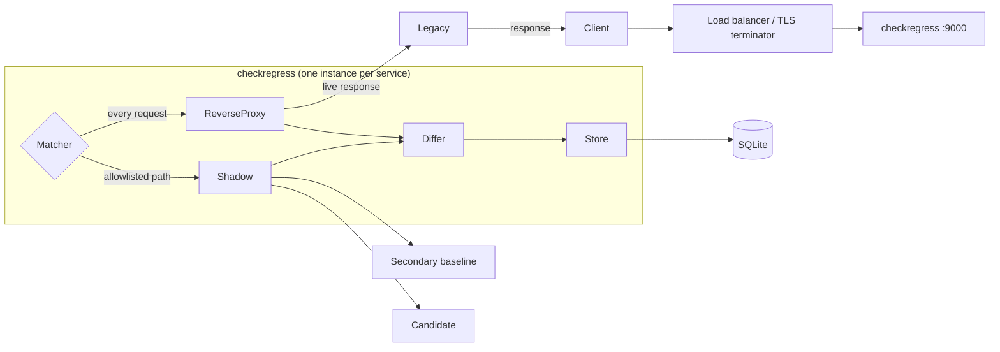

# checkregress

A shadow-traffic reverse proxy that finds regressions in your software
rewrites _before_ your users do.

checkregress sits in front of your **legacy** service and mirrors a subset of
live traffic to your **candidate** (the rewrite), compares the two responses,
and stores the differences in a local SQLite database. You get a continuous,
real-traffic view of where the new system diverges from the old one without
ever risking the live response.

---

## What is checkregress?

During a migration or rewrite, the hardest regressions to catch are the ones
that only show up on real traffic, a header that appears in a different order,
a JSON field that is missing or re-typed, a status code that flips for a small
subset of users. Small but noticeable regressions that are easy to miss in unit and regression tests.

checkregress solves this by **shadowing** real requests. For every request it
receives on an allowlisted path, it:

1. forwards the request to the **legacy** system and returns _that_ response to
   the client (the client is never affected by the shadow)
2. mirrors the same request, in the background, to the **candidate** (your
   rewrite) and an optional **secondary** (a second legacy instance used as a
   baseline)
3. diffs the legacy response against the candidate response using the
   secondary to filter out fields that change per request and
4. persists the diff to a local SQLite database for later analysis

One checkregress instance fronts exactly one service. To migrate `N` services,
run `N` instances, each with its own `config.yml`.

> **Important:** checkregress only diffs requests on **allowlisted paths**.
> Every other request is proxied straight through to legacy.

---

## Architecture

```
Client ──► Load balancer / TLS ──► checkregress ──► Legacy (live response back to client)
                                      │
                                      └─(allowlisted path, async)─► Secondary (baseline)
                                      │                              Candidate (new)
                                      ▼
                                   Differ (legacy vs candidate, baseline-filtered)
                                      │
                                      ▼
                                   Store (batched) ──► SQLite
```



---

## Integration

checkregress is a **transparent proxy**: it fronts your legacy service, so you
deploy it wherever that service is reachable and point traffic at it instead.

### Kubernetes

Run checkregress as a pod in your cluster, either as its own `Deployment`
next to the legacy service, or as a sidecar in the same pod. It points at the
legacy service by its in-cluster address, mirrors requests to the candidate
and secondary the same way, and writes diffs to its own local SQLite file.

Because each instance owns its own SQLite file, copies don't share state or
need to coordinate.

### Load balancer / reverse proxy

Place a load balancer (or any reverse proxy you already run e.g nginx, an
ingress controller, a cloud load balancer, etc.) in front of checkregress.
It terminates TLS and forwards plain HTTP to checkregress's `listen` address.
Your existing routing and health checks can point at checkregress instead of
the legacy service directly, and checkregress forwards to legacy from there.

### Requirements

- `legacy`, `candidate`, and optionally `secondary` endpoints reachable from
  the checkregress instance.

---

## Configuration

checkregress is configured with a single `config.yml` file in its working
directory. The SQLite database is created automatically on first
start, so there is nothing else to set up.

### `config.yml`

```yaml
# Public reverse proxy listener (host:port). An empty host binds all interfaces;
# in production a load balancer / TLS terminator sits in front of this.
listen: ":9000"

# Admin API listener (upcoming feature). The host must be a literal IP.
admin_listen: "127.0.0.1:9001"

# Timeouts, in milliseconds. shadow_timeout_ms must be strictly less than
# e2e_timeout_ms.
shadow_timeout_ms: 10000 # defines the max time for a single shadow hop
e2e_timeout_ms: 60000 # defines the overall request deadline
read_header_timeout_ms: 5000 # defines the header read deadline (blocks Slowloris)
idle_timeout_ms: 120000 # defines the idle keep-alive connection cleanup

# Max bytes captured from each response body for diffing (64 KiB - 10 MiB).
max_body_bytes: 1048576

# Path to the SQLite database file. Created automatically on
# first start. Defaults to "checkregress.db" if omitted.
database_path: "checkregress.db"

route:
  legacy: "http://users-legacy:8080" # source of truth for every comparison
  secondary: "http://users-legacy-staging:8080" # optional baseline, defaults to legacy if omitted
  candidate: "http://users-v2:8081" # the new system being diffed
  paths: # ServeMux patterns to shadow (method-aware) https://pkg.go.dev/net/http#ServeMux
    - "GET /api/users/{id}"
    - "POST /api/users"
    - "PATCH /api/users/{id}"
    - "GET /api/users/{id}/posts"
    - "/api/health"
```

| Field                    | Required | Default           | Notes                                                                                        |
| ------------------------ | -------- | ----------------- | -------------------------------------------------------------------------------------------- |
| `listen`                 | yes      | -                 | `host:port`, an empty host binds all interfaces.                                             |
| `admin_listen`           | yes      | -                 | Upcoming feature. Literal IP only and must differ from `listen`.                             |
| `shadow_timeout_ms`      | no       | `5000` (5s)       | Max time for a single shadow hop. Must be `< e2e_timeout_ms`, max `30000`.                   |
| `e2e_timeout_ms`         | no       | `60000` (60s)     | Overall request deadline. Max `600000`.                                                      |
| `read_header_timeout_ms` | no       | `5000` (5s)       | Header read deadline (blocks Slowloris). Max `60000`.                                        |
| `idle_timeout_ms`        | no       | `60000` (60s)     | Idle keep-alive cleanup. Max `600000`.                                                       |
| `max_body_bytes`         | no       | `1048576` (1 MiB) | Body bytes captured per response for diffing. Min `65536` (64 KiB), max `10485760` (10 MiB). |
| `database_path`          | no       | `checkregress.db` | Path to the SQLite database file. Created automatically on first start.                      |
| `route.legacy`           | yes      | -                 | `http(s)` URL of the legacy service. Must differ from `candidate`.                           |
| `route.secondary`        | no       | `route.legacy`    | Baseline for filtering dynamic fields. Must differ from `candidate` if specified.            |
| `route.candidate`        | yes      | -                 | `http(s)` URL of the new rewritten system.                                                   |
| `route.paths`            | no       | `[]`              | `http.ServeMux` patterns to shadow. Empty means no shadowing.                                |

## Building & running

```bash
make build    # builds ./bin/checkregress
make run      # builds and runs
make test     # runs all tests with -race
make audit    # runs vet, staticcheck, govulncheck, and tests
```

checkregress reads `config.yml` from its working directory at startup and
fails fast if it is missing or invalid. The SQLite database is created
automatically on first start.

---

## Upcoming features

- **Admin API** (`admin_listen`): a query interface over the stored regression
  data, letting you efficiently retrieve and inspect the diffs this application
  has captured. The listener is already configured and validated; the serving
  implementation is in progress.
